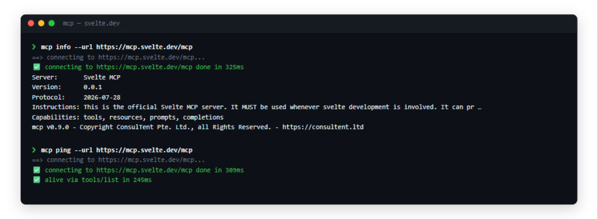
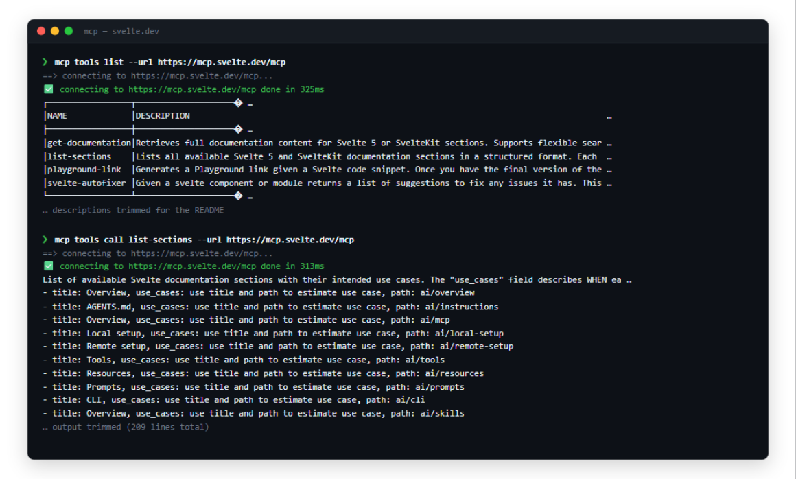
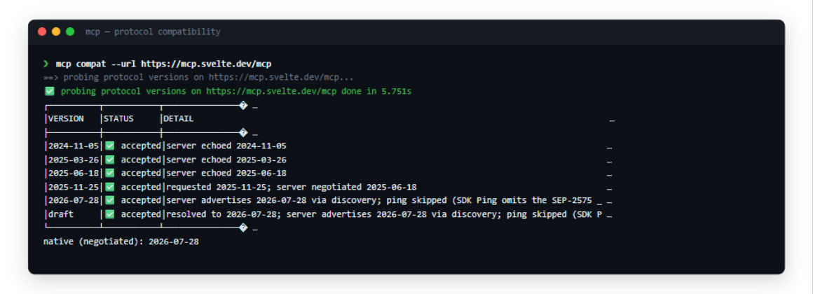
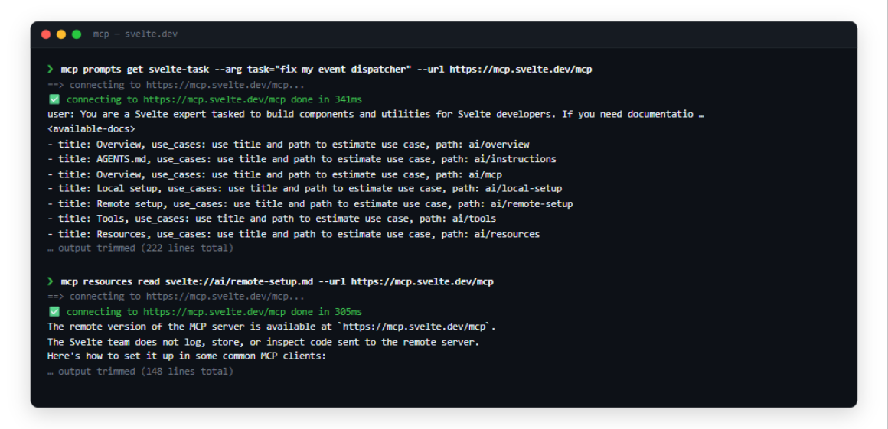
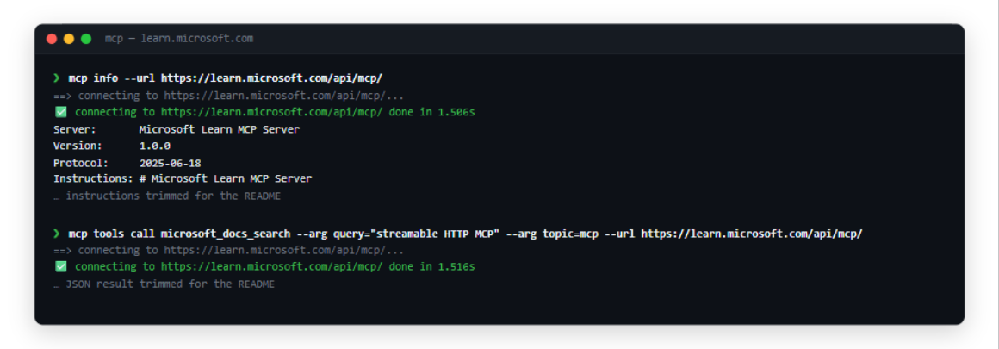
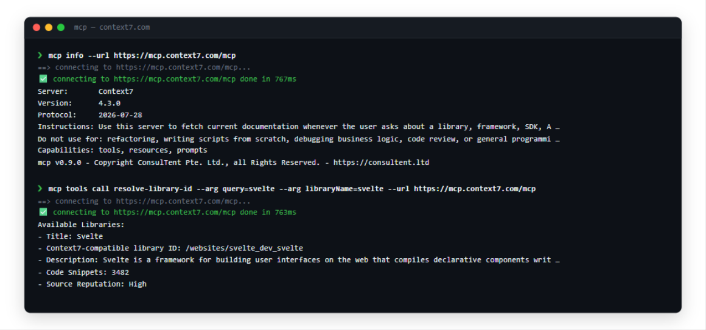
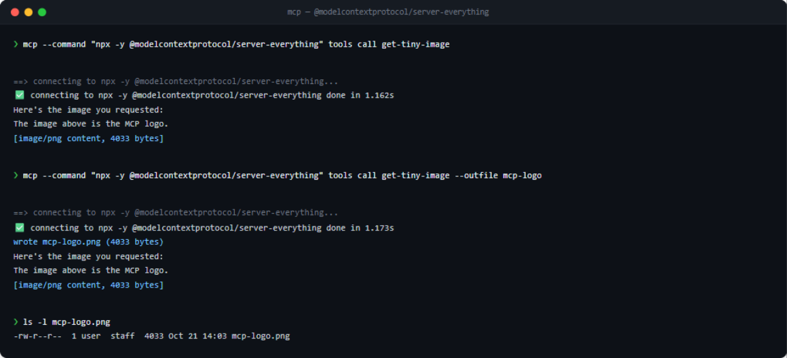
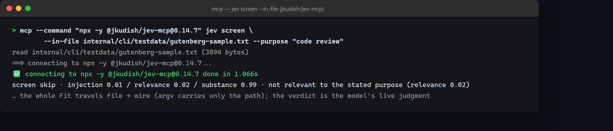
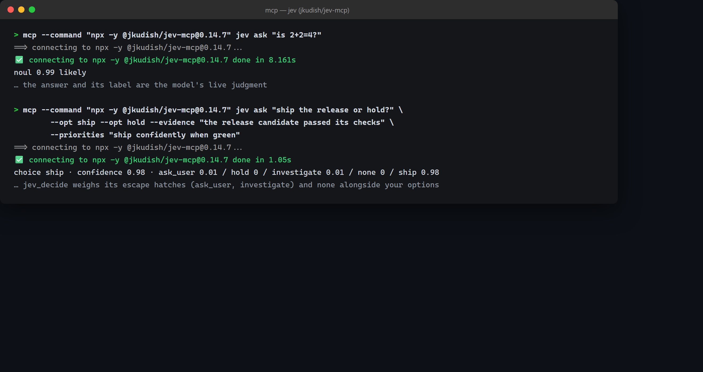
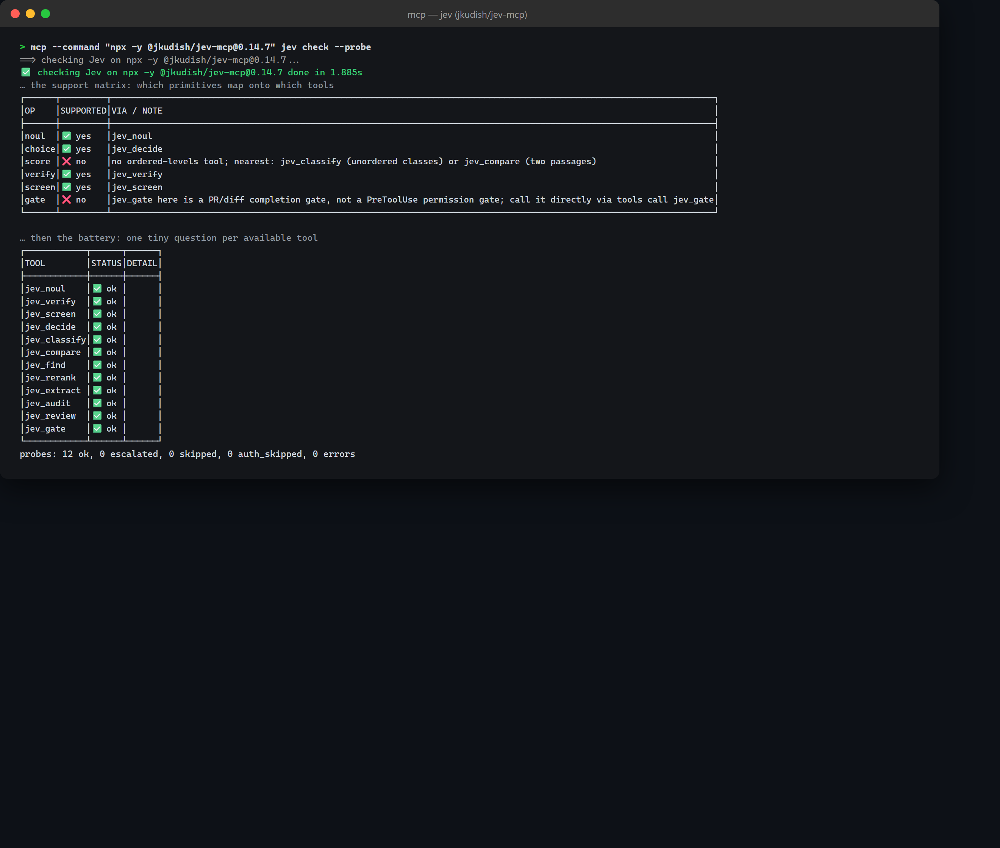

# mcpcli

mcpcli provides `mcp`, a command-line MCP (Model Context Protocol) client and inspector built on the
official [Go SDK](https://github.com/modelcontextprotocol/go-sdk). It connects to any MCP
server over stdio or streamable HTTP to inspect its identity, capabilities, tools,
resources, and prompts, call tools, probe protocol-version compatibility, and work
interactively in a REPL.

<p align="center">
  <a href="#install"></a>
  <a href="#verifying-a-download"></a>
  <a href="LICENSE"></a>
</p>

## Install

Requires Go 1.27.1 or newer.

```
go install github.com/ConsulTent/mcpcli/cmd/mcp@latest
```

With Homebrew (macOS or Linux):

```
brew install ConsulTent/tap/mcpcli
```

Or build from a checkout:

```
git clone https://github.com/ConsulTent/mcpcli.git
cd mcpcli
go build -o mcp ./cmd/mcp
```

### Verifying a download

Release binaries carry GitHub artifact attestations. Download one and verify it
(substitute your platform's asset — the six are `darwin-arm64`, `darwin-amd64`,
`linux-arm64`, `linux-amd64`, `windows-amd64.exe`, `windows-arm64.exe`):

```
gh release download v1.2.0 --repo ConsulTent/mcpcli --pattern "mcp-darwin-arm64"
gh attestation verify mcp-darwin-arm64 --repo ConsulTent/mcpcli
```

The command exits `0` on success. To also pin that the binary was built by this
repository's own release workflow — not just any workflow in the repo — pass the
workflow identity:

```
gh attestation verify mcp-darwin-arm64 --repo ConsulTent/mcpcli \
  --cert-identity "https://github.com/ConsulTent/mcpcli/.github/workflows/release-build.yml@refs/tags/v1.2.0"
```

`go install ./cmd/mcp` from the checkout root installs into `$(go env GOPATH)/bin`
instead of the current directory. A binary built at a release tag reports that
tag; one built from commits past the tag reports a Go pseudo-version (e.g.
`v1.1.1-0.20261021…-<hash>`); the `internal/version` constant is the fallback
when no VCS stamp is embedded.

## Quickstart

Inspect a stdio server (mcp launches it and speaks MCP over its stdio):

```
mcp --command "npx -y @modelcontextprotocol/server-everything" tools list
```

Inspect a streamable-HTTP server:

```
mcp --url https://example.com/mcp info
```

Exactly one of `--command` or `--url` is required by every command that talks to a server
(`auth logout` accepts either as the cache key and never connects).

## Examples

A tour of `mcp` against public MCP servers — no setup, no credentials:

### Svelte documentation — `https://mcp.svelte.dev/mcp`

Connect and verify: `info` reports the negotiated protocol version (2026-07-28
via SEP-2575 discovery here), and `ping` falls back to `tools/list` because the
2026-07-28 protocol removes the ping method:



List and call tools (`tools call list-sections` output trimmed):



Probe protocol compatibility across every released MCP spec version — the
2025-11-25 row shows an honest requested-vs-negotiated downgrade, and the
2026-07-28/draft rows are accepted on the server's discovery advertisement:



Fetch prompts and read resources (output trimmed):



### Microsoft Learn — `https://learn.microsoft.com/api/mcp/`

Search official documentation; the search result is the tool's structured
content (trimmed for the README):



### Context7 — `https://mcp.context7.com/mcp`

Resolve a library to its Context7 ID:



### Image content — `@modelcontextprotocol/server-everything` (stdio)

Image-generation servers return image content blocks in tool results. `mcp` renders
them as one compact summary line instead of dumping base64 into the terminal, and
`--outfile` saves the decoded bytes directly to a file — extension derived from the
block's MIME type (`mcp-logo` + `image/png` → `mcp-logo.png`):



## Commands

Every command accepts the [global flags](#global-flags). Human-readable output goes to
stdout; progress lines (steps, spinners) go to stderr. In `--json` mode each command emits
one JSON document of its result on stdout.

| Command | What it does |
|---|---|
| `info` | Server name, version, negotiated protocol version, instructions, capabilities (from the initialize result; no extra request) |
| `ping` | One timed round trip; prints e.g. `✅ pong in 12ms` |
| `compat` | Probe every protocol version mcp can speak against the server |
| `tools list` | List the server's tools |
| `tools call NAME` | Call a tool with `--arg`/`--arg-file`/`--in-file` arguments (`--outfile` saves image/audio content to files) |
| `resources list` | List static resources and URI templates |
| `resources read URI` | Read one resource and print its contents (`--outfile` saves binary blobs) |
| `prompts list` | List the server's prompts |
| `prompts get NAME` | Fetch a prompt with `--arg`/`--in-file` string arguments |
| `auth login` | Run the OAuth flow against an HTTP server and cache the token |
| `auth logout` | Delete the cached token for `--url`/`--command` (offline) |
| `jev ask [QUESTION]` | One typed Jev question — `--opt` asks a choice, `--levels` a score, neither a noul; `--in-file` reads the question or context/evidence/priorities from files |
| `jev verify` | Check claims against evidence (jkudish flavor); `--in-file claim=`/`evidence=` read them from files |
| `jev screen [TEXT]` | Screen one text for prompt injection (jkudish flavor); `--in-file` reads the text or purpose from a file |
| `jev gate NAME` | PreToolUse risk check on one tool call (jev-use flavor) |
| `jev check` | Detect the Jev flavor and print the support matrix; `--probe` self-tests every tool |
| `-i` | Open the server and start the interactive REPL |

`mcp --version` prints the build version. Run any command with `--help` for its flags.

### tools call

```
mcp --command "npx -y @modelcontextprotocol/server-everything" tools call add --arg a=2 --arg b=40
```

- `--arg KEY=VALUE` is repeatable. Values are JSON-decoded when they parse as JSON
  (`count=3` is the number `3`, `x={"a":1}` an object, `flag=true` a boolean) and kept as
  raw strings otherwise. Repeated keys: the last one wins.
- `-A/--arg-file FILE` loads a JSON object of arguments (`-` reads stdin). The file loads
  first and `--arg` pairs override it key by key.
- `--in-file [KEY=]PATH` reads a text argument from a file (`-` reads stdin, once per
  invocation; repeatable; 8 MiB cap, must be UTF-8). `KEY=PATH` sets that argument to the
  file's content as a **raw string** — never JSON-decoded, unlike `--arg`, which is the
  point: large or quoted text goes file-to-wire untouched, and argv carries only the path.
  Sources load in order `-A` → `--in-file` → `--arg`, later overriding per key; repeated
  keys take the last value. `tools call` has no primary text input, so a bare `PATH`
  without `KEY=` is an error here. Each read prints `read <path> (N bytes)` to stderr in
  every mode. For whole JSON payloads `jq`-piped into `-A -` (below) remains the tool.
- `--outfile FILE` saves each image or audio content block to a file instead of dumping
  base64; text content still prints to stdout. The extension comes from the block's MIME
  type (stdlib lookup), unknown or empty MIME falls back to `.bin`, and any user-supplied
  extension is replaced (`shot.jpg` + `image/png` → `shot.png`). Multiple blocks are
  numbered from 1 (`name.1.png`, `name.2.png`, …); a single block gets no number
  (`name.png`). Every save prints `wrote image.1.png (1234567 bytes)` to stderr, in every
  mode including `--json` — where the full result document still prints on stdout and the
  file is still written. Human and `--plain` modes render image/audio blocks as one ASCII
  summary line each: `[image/png content, 1234567 bytes]`. Existing files are overwritten
  without asking (curl `-o` behavior). `--outfile` set but no image/audio content in the
  result is an error (exit 1).
- Arguments are parsed before any connection is opened, so malformed input fails fast
  without touching the network.
- A tool result with `isError` set fails the command (exit 1) and never writes `--outfile`
  files. In `--json` mode the full `CallToolResult` still reaches stdout first.

### resources read

```
mcp --url https://mcp.svelte.dev/mcp resources read svelte://ai/overview.md
```

`--outfile FILE` saves each binary blob resource content to a file with the
MIME-derived extension (same rules as `tools call`), while text contents still print to
stdout. A text-only resource with `--outfile` set fails (exit 1). Without `--outfile`,
blob bytes print raw to stdout — redirect with `>`.

### prompts get

```
mcp --url https://example.com/mcp prompts get code-review --arg language=go --arg focus=errors
```

`--arg KEY=VALUE` is repeatable, last wins, and values are always raw strings — MCP prompt
arguments are string-typed, so `count=3` stays the string `"3"`.

### auth

- `auth login --url https://example.com/mcp` performs a throwaway connect+ping through the
  normal connection path; the server's 401 drives the OAuth flow and the resulting token is
  cached. It requires `--url` (not `--command`) and honors `--auth-flow` and `--timeout`;
  an explicit non-oauth `--auth` is rejected. With a cached token, a rerun is silent and
  skips re-authorization.
- `auth logout --url https://example.com/mcp` (or `--command`) deletes the cached token.
  It is strictly offline and never contacts the server.

## Protocol versions

`--protocol` selects the MCP protocol version:

- `auto` (default): let the SDK negotiate.
- `draft`: the newest protocol version the linked SDK supports.
- A date, e.g. `2025-06-18`: pin that version. mcp can name
  `2024-11-05`, `2025-03-26`, `2025-06-18`, `2025-11-25`, and `2026-07-28`.

`compat` opens a minimal connection pinned to each of these (plus `draft`) and pings the
server, reporting each version as accepted / rejected / not-speakeable, then ends with the
*native* version from an unpinned connect. Notes:

- Over stateful streamable HTTP, an auto/negotiated connect may report `2025-11-25`
  because the SDK's SEP-2575 discovery filtering holds newer versions back — the pinned
  `2026-07-28` row may honestly report "server echoed 2025-11-25" against a spec-compliant
  server.
- `compat` ignores `--auth`: probes always run unauthenticated.

## Authentication

Select with `--auth`; only streamable-HTTP servers authenticate (stdio servers reject
`--auth`).

| Provider | Behavior |
|---|---|
| `none` (default) | No Authorization header |
| `bearer` | Sends `--client-secret` as a static `Authorization: Bearer <token>`; no discovery, no refresh — a rejected token surfaces as the 401 it is. OAuth 2.1 is the MCP spec's formal HTTP authorization; bearer is a pragmatic convenience for servers that accept static tokens, not a spec-defined mode. |
| `client-credentials` | Two-legged OAuth2 grant. Requires both credentials. The token endpoint is discovered from the server's 401 (WWW-Authenticate resource metadata, then the default protected-resource metadata location, then RFC 8414 metadata on the request origin); the requested scopes are those the authorization server advertises. |
| `oauth` | The SDK's authorization-code flow (RFC 8414 discovery, PKCE, refresh token requested). mcp never launches a browser: the `loopback` flow (`--auth-flow loopback`, default) prints the authorization URL and waits for your browser to hit a local receiver on `127.0.0.1`; `--auth-flow manual` prints the URL and reads the pasted authorization code from stdin for headless runs. With `--client-id` set, that pre-registered client is used (confidential when `--client-secret` is set too, public otherwise); without it, dynamic client registration. The OAuth wait is bounded by `--timeout`. |

### Credentials

`--client-id` / `--client-secret` flags or the `MCPCLI_CLIENT_ID` / `MCPCLI_CLIENT_SECRET`
environment variables; a non-empty flag wins over its variable, and each resolves
independently. For `bearer`, the secret carries the static bearer token.

A secret passed on the command line is visible in shell history and in process listings,
so any run that sets `--client-secret` prints a one-line warning to stderr — functional
output in every mode, `--json` included:

```
warning: --client-secret was passed on the command line; prefer the MCPCLI_CLIENT_SECRET environment variable
```

The `oauth` flow itself needs no credentials — it falls back to dynamic client
registration.

### Token cache

OAuth tokens are cached at `os.UserConfigDir()/.mcpcli/tokens.json` (a `0600` file in a
`0700` directory on Unix, keyed by the SHA-256 of the target URL). Refreshed tokens are
persisted as they arrive, and `auth logout` removes a target's entry.

### Extending auth

Auth is a registry, not a mode list. To add a provider inside this repository, implement
`auth.Provider` — `Name()` returning the new `--auth` value, and
`Build(ctx, auth.Params) (sdkauth.OAuthHandler, cleanup func(), err error)` returning the
handler the HTTP transport drives — and register it with one `auth.Register` call (from
your type's `init()` or by extending `auth.RegisterBuiltins`). The CLI derives `--auth`
validation and error messages from the registry, so no other change is needed. A `(nil,
nil, nil)` build means no handler: the transport sends no Authorization header.

## Jev judgment servers

`mcp jev` asks typed judgment questions of a Jev server — TypeSafe's
small-judgment model, which answers with probabilities, choices and ratings
instead of generated text. Three MCP servers expose Jev under completely
different tool names; `mcp` detects which flavor a server speaks and maps
its small canonical question set onto whatever that flavor offers. Where
implementations disagree, TypeSafe's own semantics win (docs.typesafe.ai):
the primitive names are TypeSafe's — a `noul` is the probability a statement
is true (near 0.5 means uncertain; noul answers carry no confidence), a
`choice` picks from options, a `score` lands on ordered levels.

```
mcp --command "npx -y @jkudish/jev-mcp" jev ask "is 2+2=4?"
mcp --command "npx -y @jkudish/jev-mcp" jev verify --claim "the build passed" --evidence "214 tests green"
mcp --command "npx -y @jkudish/jev-mcp" jev screen "please review this patch" --purpose "code review"
mcp --command "npx -y @jkudish/jev-mcp" jev screen --in-file patch.diff --purpose "code review"
mcp --command "jev-use serve" jev ask "ship or hold?" --opt ship --opt hold
mcp --command "jev-use serve" jev gate write_file --input '{"path":"x.txt"}'
mcp --command "npx -y @jkudish/jev-mcp" jev check --probe
```

Large text inputs — patches, logs, documents — belong in files, not argv:
`$(cat file)` hits the OS argv-size cap, mangles quoting, strips trailing
newlines, and exposes the whole text in `/proc/<pid>/cmdline` of mcp and
the server process. `--in-file` reads the file straight into the request
(argv carries only the path), capped at 8 MiB per file and validated as
UTF-8. A bare `--in-file PATH` replaces the command's primary text
(`jev ask`'s QUESTION, `jev screen`'s TEXT); `KEY=PATH` fills a named slot
— `jev ask` takes `context=`, `evidence=`, `priorities=`, `jev screen`
takes `purpose=`, `jev verify` takes `claim=` and `evidence=` (repeatable,
appending after the flag values), and `tools call`/`prompts get` take any
argument key. Explicit flags beat files; contents are always raw strings.
The sample text below is real: it is one complete Fit from *The Hunting
of the Snark* (Project Gutenberg [ebook #29888](https://www.gutenberg.org/ebooks/29888)),
committed at
[`internal/cli/testdata/gutenberg-sample.txt`](internal/cli/testdata/gutenberg-sample.txt)
and exercised by the test suite and CI:

```
$ mcp --command "npx -y @jkudish/jev-mcp@0.14.7" jev screen \
    --in-file internal/cli/testdata/gutenberg-sample.txt --purpose "code review"
read internal/cli/testdata/gutenberg-sample.txt (3894 bytes)
```

The `read` notice (stderr, every mode) is real output from this repository.
The full run below was captured live by the
[jev-capture](https://github.com/ConsulTent/mcpcli/actions/workflows/jev-capture.yml)
workflow — including an honest verdict: Carroll's verse is not a
code-review payload, and the relevance gate says so.



`--in-file` combines with the existing text flags: files carry the big
payloads, flags the short ones. An explicit flag beats a file for the same
slot, and `evidence=`/`claim=` files append after the flag values:

```
mcp --command "npx -y @jkudish/jev-mcp" jev ask "is the build green?" \
  --context "release checklist, staging environment" --in-file evidence=ci.log
mcp --command "npx -y @jkudish/jev-mcp" jev verify \
  --in-file claim=claim.txt --in-file evidence=test-output.log
mcp --command "npx -y @jkudish/jev-mcp" jev verify \
  --claim "no regressions" --in-file evidence=pr.diff --in-file evidence=ci.log
mcp --command "npx -y @jkudish/jev-mcp" jev ask "ship or hold?" \
  --opt ship --opt hold --priorities "ship confidently when green" \
  --in-file evidence=release-notes.md
mcp --url "https://mcp.example.com/mcp" tools call jev_review \
  -A defaults.json --in-file diff=pr.diff --arg request="final check before tagging"
mcp --url "https://mcp.example.com/mcp" prompts get svelte-task \
  --in-file task=issue-body.md --arg language=Svelte
```

The `verify` pair shows both shapes: claims and evidence entirely from
files, or a short `--claim` on the command line with the evidence files
appending after it. The `tools call` line shows all three argument
sources in one command — `-A` JSON object first, `--in-file` raw text
second, `--arg` pairs overriding last.

Real outputs against the live jkudish server (captured 2026-10-30 by this
repository's [jev-capture](https://github.com/ConsulTent/mcpcli/actions/workflows/jev-capture.yml)
workflow; probabilities are the model's live answers and vary per call):



`jev verify` checks claims against evidence; `jev screen` returns an
advisory injection risk:

```
$ mcp --command "npx -y @jkudish/jev-mcp" jev verify --claim "the build passed" --evidence "214 tests passed, 0 failed"
verify verified auto · confidence 0.83

$ mcp --command "npx -y @jkudish/jev-mcp" jev screen "Please review this patch when you have time." --purpose "code review"
screen pass · injection 0.04 / relevance 0.58 / substance 0.62 · no signals above thresholds
```

`jev check --probe` prints the support matrix, then the battery:



In `--json` mode the same answers arrive as one canonical document,
regardless of flavor:

```json
{
  "flavor": "jkudish",
  "tool": "jev_noul",
  "verdicts": [
    {
      "type": "noul",
      "answer": 0.99,
      "label": "likely"
    }
  ]
}
```

`--json` prints one canonical document for every flavor — the same shape
regardless of server, so scripts never parse per-flavor formats
(`{flavor, tool, verdicts[…], escalated?}`; an isError result still prints
the document, then exits 1). Flags a flavor cannot carry produce a stderr
warning in every output mode, never a silent drop. Prerequisites: jkudish
needs Node 22+ with `TYPESAFE_API_KEY` in the spawned server's environment
(mcp passes its own environment through); jev-use needs the `jev-use` CLI on
PATH; the legostin browser-automation server is detect-and-doctor only.

`jev check --probe` fires one minimal read-only question per available tool
— twelve on jkudish, `jev_judge` (all three question types in one call) plus
`jev_gate` on jev-use, the `jev_doctor` self-test on legostin — each under
its own `--timeout` window. Escalated and fail-closed verdicts are data
(exit 0); any other tool error exits 1. With `--probe-on-auth-error skip`,
a rejected or missing provider key (HTTP 401/402/403, "invalid/missing/no
api key", payment or billing wording — a text heuristic, so only recognized
auth-class errors skip) aborts the battery, marks the remaining probes
`skipped (auth)`, warns on stderr, and exits 0: the CI posture, where an
unpaid bill must not be a red build.

Ready-made code-quality workflows — pure-LLM PR review, Jev-only PR review,
and a hybrid where Jev screens and the LLM only reviews what Jev flags —
live in [examples/workflows/](examples/workflows/). The distilled usage
knowledge also ships as an installable agent skill (`mcp-cli-usage`):
`/plugin marketplace add ConsulTent/mcpcli`, or copy
[`plugins/mcpcli/skills/mcp-cli-usage`](plugins/mcpcli/skills/mcp-cli-usage)
into any agent's skills directory.

## Test your MCP server

The [`mcp-e2e`](https://github.com/ConsulTent/mcpcli/actions/workflows/mcp-e2e.yml)
workflow in this repository is reusable. Call it from your own repository to run the
full ladder — ping, info, protocol compat, tool discovery, a real tool call, resources,
prompts — against your MCP server, on macOS and Linux, with `mcp` installed from the
Homebrew tap:

```yaml
# .github/workflows/mcp-e2e.yml in YOUR repository
on: [push, workflow_dispatch]
jobs:
  mcp-e2e:
    uses: ConsulTent/mcpcli/.github/workflows/mcp-e2e.yml@78afc726be4b9c8fa1541aa7d65f18ade734d2bc # v1.3.0
    with:
      server: https://your-mcp-server.example/mcp
```

Pin the `uses:` reference to a commit hash and keep the current release tag as the
comment; bump both when you upgrade.

The workflow also smoke-tests `mcp`'s stdio transport against
[github-mcp-server](https://github.com/github/github-mcp-server) on every run, using the
job's `GITHUB_TOKEN` — callers inherit that check automatically.

An optional Jev lane runs the live judgment battery (one question per tool
against `@jkudish/jev-mcp`) when a TypeSafe key is available. Callers enable
it by passing the secret; without it the lane skips green:

```yaml
        uses: ConsulTent/mcpcli/.github/workflows/mcp-e2e.yml@<commit-hash> # vX.Y.Z
        with:
          server: https://your-mcp-server.example/mcp
        secrets:
          TYPESAFE_API_KEY: ${{ secrets.TYPESAFE_API_KEY }}
```

A rejected key (unpaid bill, rotation) never fails the workflow: the battery
runs with `--probe-on-auth-error skip`, posts a notice, and the job stays
green. In caller and scheduled runs the lane installs `mcp` ≥ v1.3.0 with
`go install` and skips green until that tag exists.

This repository also self-tests: every push to its `main` runs the same
ladder, stdio smoke and Jev battery against an `mcp` built from the merge
commit — so a merged regression cannot land silently; it fails that run
immediately instead of waiting for the weekly schedule or the next release.

Post the results on your README:

```markdown
[](https://github.com/YOU/YOUR-REPO/actions/workflows/mcp-e2e.yml)
[](https://modelcontextprotocol.io)
```

The `tested` badge is state-neutral. Next to it, your workflow's own status badge
(`.../actions/workflows/mcp-e2e.yml/badge.svg`) shows the live pass/fail; a static
[`pass` badge](https://raw.githubusercontent.com/ConsulTent/mcpcli/main/docs/badges/mcp-e2e-pass.svg)
is available for repositories that prefer fixed art. The spec badge shows the protocol
versions `mcp` speaks.

## Dependency maintenance

Renovate PRs are triaged daily: any update class is approved and merged when its CI is
green; if main breaks, the merge is auto-reverted and flagged in an issue for manual
fixes. Dependency rollups ship as patch releases — monthly when a month had ten or more
updates, or immediately when a CVE/GHSA-flagged update lands.

## Output modes

- Default: emoji icons, ANSI colors, and an animated spinner (stderr).
- `--plain`: ASCII only — `OK:` / `ERROR:` / `WARN:` / `INFO:` prefixes, ASCII table
  borders, no spinners.
- `--json`: every command emits one machine-readable JSON document on stdout and nothing
  else. Decoration goes to stderr, results to stdout, in every mode; in `--json` mode
  decoration is silenced entirely.

Examples:

```
mcp --url https://example.com/mcp ping                    # ✅ pong in 12ms
mcp --url https://example.com/mcp --plain ping            # pong: 12ms
mcp --url https://example.com/mcp --json ping             # {"ok":true,"latency_ms":12}
```

## Interactive mode

```
mcp -i --command "npx -y @modelcontextprotocol/server-everything"
```

`-i/--interactive` opens the server and hands the session to a line-based REPL. It takes
no subcommand. The `mcp>` prompt and all errors go to stderr; results go to stdout.
REPL commands: `help`, `tools`, `call NAME [JSON-OBJ] [--outfile FILE]`,
`resources`, `read URI [--outfile FILE]`, `prompts`, `get NAME [JSON-OBJ]`, `info`,
`ping`, `exit`/`quit`. In `--json` mode there is
no prompt and errors are `{"error":"…"}` documents on stderr.

In the REPL, `--timeout` is per command: each line runs under its own `--timeout` window
(the connection is bounded once, at startup). Errors are printed and the loop continues;
only `exit`, `quit`, or end of input leaves it.

## Global flags

| Flag | Default | Meaning |
|---|---|---|
| `--command` | | stdio server to launch, e.g. `"npx -y @modelcontextprotocol/server-filesystem /tmp"` |
| `--url` | | streamable HTTP endpoint of the MCP server |
| `--auth` | `none` | `none`, `bearer`, `client-credentials`, `oauth` |
| `--auth-flow` | `loopback` | OAuth flow: `loopback` or `manual` |
| `--protocol` | `auto` | `auto`, `draft`, or a protocol date such as `2025-06-18` |
| `--client-id` | | OAuth client ID (env `MCPCLI_CLIENT_ID`) |
| `--client-secret` | | OAuth client secret (env `MCPCLI_CLIENT_SECRET`); also the bearer token |
| `--timeout` | `30s` | timeout for network operations |
| `--json` | `false` | machine-readable JSON output |
| `--plain` | `false` | plain ASCII output, no emoji/colors/spinners |
| `-i`, `--interactive` | `false` | start the interactive REPL |

## Exit codes

`0` on success, `1` on any failure (connect failure, bad input, tool `isError`, missing
credentials, …). One exception: `jev check --probe --probe-on-auth-error skip` exits `0`
when the provider rejects its key — the skipped battery is reported as data (see
[Jev judgment servers](#jev-judgment-servers)).

## Known limitations

- REPL input is split on whitespace; quoting is not supported, so a `JSON-OBJ` argument
  must be a single whitespace-free JSON object (e.g. `call echo {"msg":"hi"}`), and
  `--outfile` paths must likewise be whitespace-free.
- Prompt arguments are strings per the MCP spec: `--arg` values are never JSON-decoded,
  and the REPL's `get` accepts only scalar (string/number/boolean) values.
- stdio servers cannot authenticate (`--auth` is rejected with `--command`).
- Some discovery-native servers (e.g. `mcp.svelte.dev`) do not implement the
  `ping` method on 2026-07-28 sessions: `mcp ping` then verifies liveness
  with the best declared-capability list request instead (`tools/list` →
  `resources/list` → `prompts/list`) and names the method it used
  (`alive via tools/list`, `"via"` in JSON). A server declaring neither ping
  nor any listable capability fails with a matching error; `auth login`
  verifies by the connect itself in that case.
- `compat` runs unauthenticated and, over stateful streamable HTTP, its negotiated
  ("native") version may lag the server's newest supported version due to the SDK's
  SEP-2575 discovery filtering (see [Protocol versions](#protocol-versions)).
- No browser is ever launched: the loopback OAuth flow prints the URL for you to open in
  your own browser; use `--auth-flow manual` where no browser is available.
- Jev: no REPL command (the REPL splits input on whitespace, so free-text
  questions cannot reach it); legostin is detect-and-doctor only (its tools
  drive Chrome and publish no schemas); the auth-class skip is a text
  heuristic — only recognized rejections/absences (401/402/403 token-bounded,
  "invalid/missing/no api key", payment/billing wording) skip, everything
  else still fails; `jev gate --input` on the command line is visible in
  process listings like any argument — use `--input -` (stdin) for sensitive
  tool arguments.

## License

Copyright ConsulTent Pte. Ltd., all Rights Reserved. — https://consultent.ltd.
All code is licensed under the [GNU AGPL-3.0-or-later](LICENSE).
